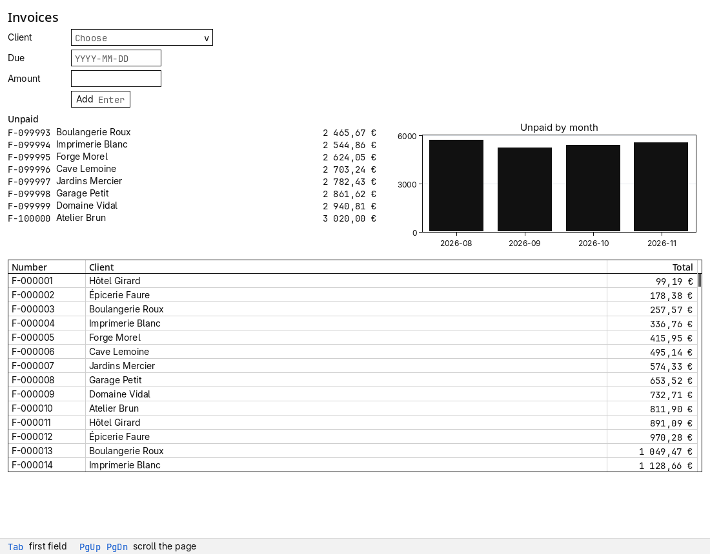

# Ceres

Ceres is the user interface of an app written in [Cesia](https://github.com/www-celestial/cesia-lang): one API for
every platform, the page drawn pixel by pixel by Ceres itself, as Flutter draws, and its data live from the app's
server. A page is a function that gives widgets. Data that changes lives in **signals**, and a function given where a
widget goes is a **live part**, run again when a signal it read changes, and only it: there is no virtual DOM, and no
frame is made while nothing changes.

Its look is plain on purpose: ink on paper, edges of one pixel, dense rows, tables with real edges and a header, labels
beside their fields, every action a button or a key in sight, numbers at the right in the code font, errors in plain
words beside what they concern. A theme changes all of it.

The family: [Cesia](https://www-celestial.github.io/cesia-lang/) (the language) · [Cemacs](https://www-celestial.github.io/cemacs/) (the editor) ·
[Cepheus](https://www-celestial.github.io/cepheus/) (the database) · [Ceti](https://www-celestial.github.io/ceti/) (the browser driver).

```cesia
use deps/www-celestial/ceres/src/form
use deps/www-celestial/ceres/src/web
use std/plot

defn Page(p)
  (** /invoices: add an invoice, the unpaid ones live, every invoice in a table, the unpaid sum by month. *)
  clients = web.Live("clients", p)
  unpaid = web.Live("unpaid", p)
  months = web.Live("months", p)
  draft = form.New({Client: missing, Due: missing, Amount: missing}, Invoice)
  web.Stack([
    web.Title("Invoices"),
    form.View(draft, () -> web.Act("addInvoice", form.Values(draft), p), [
      form.Choice("Client", clients, c -> c.Id, c -> c.Name), form.Date("Due"), form.Number("Amount"), form.Submit("Add"),
    ]),
    web.Row([
      web.Grow(web.Stack([
        web.Text("Unpaid", font = "strong"),
        web.Each(unpaid, i -> i.Invoice, i -> web.Row([web.Text(i.Number, font = "code"), web.Text(i.BillTo), web.Spacer(), web.Money(i.Total)])),
      ])),
      web.Plot(() -> plot.Of([plot.Bars([m.Month for m in web.Get(months)], [m.Total for m in web.Get(months)])], title = "Unpaid by month"), width = 480, height = 220),
    ], align = "start", gap = 24),
    web.Table(web.Pages("all", p), [
      web.Column("Number", i -> i.Number, sort = "Number", width = 120),
      web.Column("Client", i -> i.BillTo, sort = "BillTo"),
      web.Column("Total", i -> web.Money(i.Total), width = 140),
    ], height = 330, label = "All invoices"),
  ])
end

App = web.App([web.Route("/invoices", Page)], live = "/live", title = "Invoices")
```



The page names the **shows** and the **actions** of the app's live screen (`std/live`); it writes no question. The
server writes them, a `cepheus.Watch` for the unpaid invoices for instance, and pushes their changes; the form checks
its fields as one types with the same rules (`Invoice`) that the server checks again before it writes; the table asks
the app for a window of 100 rows at a time, so 100,000 rows scroll as 100 do.

## Where it runs

Every back-end paints one **draw list** (rectangles, frames, texts, lines, triangles, groups that move and clip) and
mirrors one **semantics tree** (roles, names, values, places, focus), which Ceres makes:

- **headless**, for tests: the draw list and the tree as text, checked with `test.Snapshot`, events sent as a person
  would (`headless.ClickOn("Name", page)`, `headless.Type("Ana", page)`), the live screen against a real server;
- **SDL3**, a window on Linux, Windows and macOS, as Cemacs draws: `sdl.Run(App, origin = "http://127.0.0.1:8090")`;
- **the browser**: the page's code compiled from Cesia to WebAssembly (`cesia build --target wasm`), in Chrome 137,
  Firefox 153 and Safari 27 or later; `web/ceres.js`, 5.8 KB in brotli, paints the draw list with WebGL2 and keeps the
  tree as a hidden DOM for screen readers, typing and find. See [Ceres in a web page](docs/book/web.md).

## Install

Ceres is a dependency like any other: a git repository and a tag, in the `[deps]` of `cesia.toml`.

```toml
[deps.ceres]
from = "github.com/www-celestial/ceres"
version = "v0.1.0"
take = ["src/web", "src/form", "src/serve", "src/sdl", "src/headless"]
```

A window needs SDL3 and SDL3_ttf on the machine, and `--allow ffi=SDL3,ffi=SDL3_ttf,read=deps/www-celestial/ceres/src/sdl/fonts`:
`ffi=` is total trust, as for any C library. The tests need nothing but Cesia 1.3.

## Speed

On a laptop of 2015, in a window of SDL3: a frame of the invoices page takes **1.2 to 1.9 ms** (p50), of which Ceres
0.2 to 1.1 ms and the rest SDL's painting; a notch of the wheel in a table of 100,000 rows **1.2 ms**; a key typed in a
field **1.5 ms**. At rest the page draws nothing and takes **0.2 %** of a core, the wait for what the app pushes; the
page itself takes 9 MB. [Speed](docs/book/speed.md) has every measure, how it was taken, and where Flutter and SolidJS
still do better.

## More

- [The tutorial](docs/book/guide.md): a client list with a form, live from Cepheus, from the project to its test.
- [Widgets](docs/book/widgets.md), [Forms](docs/book/forms.md), [Live data](docs/book/live.md),
  [Ceres in a web page](docs/book/web.md), [Back-ends](docs/book/backends.md), [Speed](docs/book/speed.md).
- `cesia do demo` opens the invoices page in a window, live from its app served in the same program; `cesia do shots`
  draws the pictures of `shots/` without a screen; `cesia do bench` and `cesia do still` take the measures;
  `tools/webshot.sh` plays the invoices page compiled to WebAssembly in Chrome without a window.
- Not yet: animations, images, text right to left, a screen reader on the desktop, `live.Pages` in `std/live` (a table
  kept live while it scrolls).

MIT licence.
