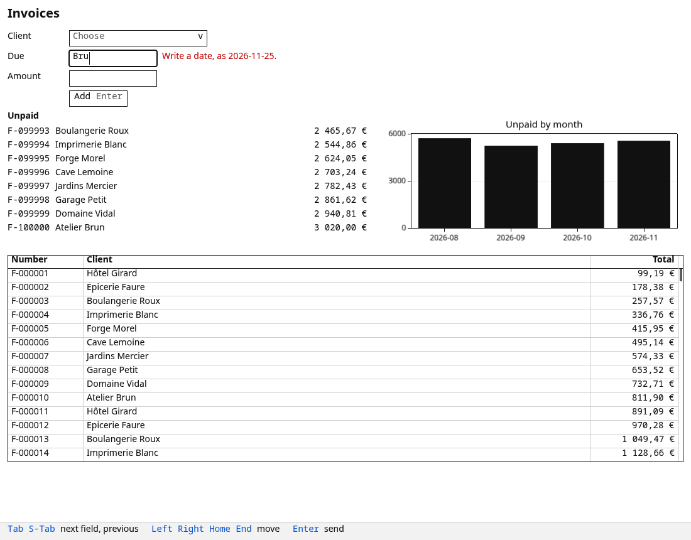

# Back-ends

Ceres lays a page out and draws it itself, into a *draw list*: rectangles, frames, texts, lines, filled triangles, and
groups that move and clip them. Every back-end paints that list, and nothing else: so a page has the same pixels in a
window, in a test and in a browser, compiled to WebAssembly. Beside it, the *semantics tree* says what each
widget is for a screen reader: its role, its name, its value, its place, the focus.

A back-end keeps the page's state and calls four functions of `web`:

- `web.Start(app, width, height, measure, origin = ..., path = ...)` mounts the app, its texts measured by
  `measure`, `{Width: (text, size, font) -> pixels, Line: size -> pixels}`;
- `web.Handle(event, page)` for each event: `{Kind: "mouse", Action, X, Y, Amount}`, `{Kind: "key", Key, Ctrl, Alt,
  Shift}`, `{Kind: "text", Text}`, `{Kind: "resize", Width, Height}`;
- `web.Update(page)` once each turn of its loop: it takes in what the live screen pushed and runs the live parts whose
  signals changed;
- `web.Frame(page)`, the draw list, only when `web.Changed(page)`; then `web.Painted(page)`.

`web.Semantics(page)` gives the tree, `web.Keys(page)` the keys of the band.

## Headless, for tests

`src/headless` runs a page without a window. Its text is 7 pixels a character and 21 a line at the size 14, so every
place is known in advance. `headless.Draw(page)` gives the draw list as text, a line for each item, the groups out of
sight left out; `headless.Tree(page)` the semantics tree; `test.Snapshot` keeps either beside the test.

```cesia
use deps/www-celestial/ceres/src/web
use deps/www-celestial/ceres/src/headless

n = web.Signal(0)
page = p -> web.Row([web.Button("Add", () -> web.Set(n, web.Get(n) + 1)), () -> web.Text("Count: $(web.Get(n))")])
s = headless.ClickOn("Add", headless.ClickOn("Add", headless.Open(web.App([web.Route("/", page)]), width = 400, height = 120)))
headless.Draw(s) -->
```

`headless.Click(x, y, page)`, `headless.ClickOn(name, page)`, `headless.Press(key, page)`, `headless.Type(text, page)`,
`headless.Wheel(x, y, notches, page)` and `headless.Drag(x, y, x2, y2, page)` send the events a person would;
`headless.Settle(page, until = ...)` lets the live screen bring what the app pushed.

## SDL3, a window on the desktop

`src/sdl` paints the draw list with SDL3's renderer and SDL3_ttf, found at run time, as Cemacs draws: on Linux, Windows
and macOS. `sdl.Run(app, origin = ...)` opens a window and runs the app until it is closed; it needs
`--allow ffi=SDL3,ffi=SDL3_ttf` and `read=` for the fonts, Adwaita Sans, Noto Sans Medium and JetBrains Mono in
`src/sdl/fonts`, all under the SIL Open Font License. A still page sleeps in SDL until an event comes: no frame is
drawn while nothing changes. It wakes every 50 ms when it has a live screen, to take in what the app pushed, and every
250 ms without one. Closing the window ends `sdl.Run`, and so do TERM and INT, as in Cemacs: under `cesia run --watch`,
a change of the code closes the window and opens it again. `driver = "dummy"` runs it without a screen, and
`hidden = true` in a window of the screen's own driver, drawn by its GPU, that the screen doesn't show: the measures of
[Speed](speed.md) are taken so.

```cesia norun
use deps/www-celestial/ceres/src/sdl
use deps/www-celestial/ceres/src/web

sdl.Run(web.App([web.Route("/", p -> web.Title("Hello"))]), width = 400, height = 200)
```

`sdl.Shot(app, path, ...)` draws a page into a PNG under SDL's dummy driver, without a screen: `cesia do shots` makes
the pictures of `shots/` so. `cesia do demo` opens the invoices page of `examples/invoices`, live from its app served
in the same program, where an accountant pays an invoice elsewhere every 4 seconds.


## The browser: src/browser and web/ceres.js

In the browser, the page's code, Ceres's and the app's, runs in WebAssembly, compiled by `cesia build --target wasm`:
[Ceres in a web page](web.md) is the tutorial. `browser.Run(app, origin = ..., path = ...)` is the loop of a window,
its window the page's first `<canvas>`: it waits for the page's events on a channel, handles them, and paints at the
browser's next frame when the page changed. Its live screen opens at the page's own origin unless `origin` names
another, and its first route is the canvas's `data-path`, or `/`.

What WebAssembly can't reach, the canvas, WebGL2, the events and the DOM, goes through `web/ceres.js`: 330 lines written
by hand, no dependency, 5.8 KB in brotli, which `cesia build` copies beside the page's module. It never decides anything
about the page. The page calls it by `js.Call("../../web/ceres.js", name, args)` of `std/js`, five functions:

- `Start(events)` sets the canvas up and sends each event on `events`, a channel of `std/fiber`, as the JSON of what
  `web.Handle` takes, `{Kind: "mouse", Action, X, Y, Button, Amount}`, `{Kind: "key", Key, Ctrl, Alt, Shift}`,
  `{Kind: "text", Text}` or `{Kind: "resize", Width, Height}`; it gives `[width, height, origin, path]`;
- `Measure(text, size, font)` and `Line(size)`, the width of a text in whole pixels and the height of a line, by the
  browser's own fonts;
- `Paint(bytes)` paints the bytes of `web.Encode(web.Frame(page))` with WebGL2, in one buffer of vertices and one draw
  call for each clip: one shader, whose rounded corners are a distance function; texts are drawn once by the browser's
  own text engine into an atlas, a texture that the GPU copies, so no font is downloaded;
- `Mirror(json)` keeps the hidden DOM of `web.Semantics(page)`, an element for each node, kept by its `Id`, transparent,
  over the canvas: screen readers read it, Cmd-F finds its texts, and each field is a real `<input>`, where typing, IME,
  paste and autofill happen, the text going to the page as it comes;
- `Wake()` sends `"frame"` on the channel at the browser's next frame, the time to paint.

The bytes of the draw list: two u32, the count of f32 numbers and of bytes of text, the numbers, then the texts in
UTF-8. Each item is a code and its numbers: 1 rect and 2 frame (X Y W H Color Alpha Radius), 3 text (X Y Size Color
Alpha Font Start Length Angle), 4 line (n Width Color Alpha, then n points), 5 tris (n Color Alpha, then n points), 6 a
group (X Y W H Clip) whose items follow up to 7, its end.

The live screen is a WebSocket of the page: `std/websocket`, in a program compiled to WebAssembly, is the browser's. It
wakes the loop when it brings something (`web.Start(..., wake = events)`), so a still page runs nothing.

`tools/webshot.sh` tests it all in Chrome without a window: it builds the invoices page, serves it live, plays a person
in `tests/web/page.html`, and prints what the page showed:

```text
done 17 rows, 2 inputs, field Bru, input left "", painted again true, measure 54
```


