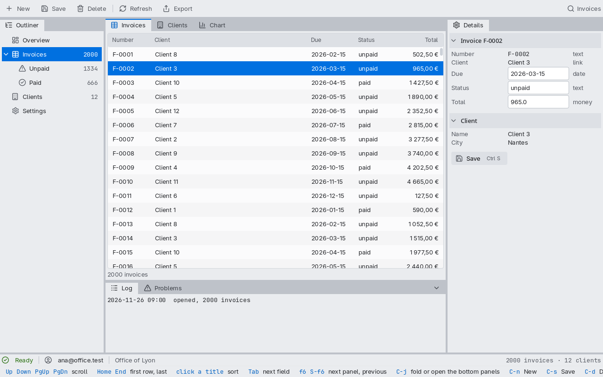
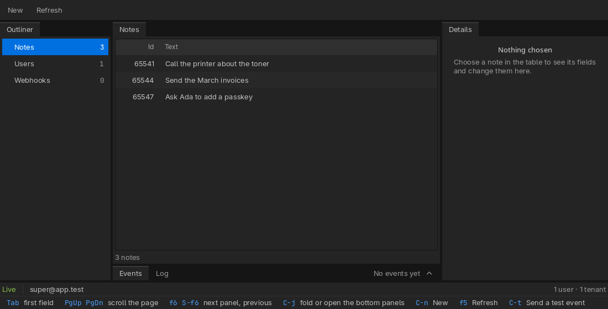

# Layout like a desktop tool

An app with much to show and many actions, as the admin of a platform or an editor, reads best laid out as a desktop
tool does it (the editor of Unreal Engine, Blender, an IDE): panels with tabs docked around a center, splitters between
them that the mouse drags, an outliner at the left, the details of what is chosen at the right, a console at the
bottom, a toolbar on top, a status bar under all. `web.Dock` is that layout, and it fills the window. An app with
little to show keeps a page in one column, a `web.Stack`: the dock is a choice of the app, and a page that makes none
of these widgets holds none of their code.




## The dock and its panels

`web.Dock(center, left, right, bottom, toolbar, status, key, sizes)` takes lists of `web.Panel(title, body, icon,
key)`: each area is a group of tabs, the panel of the chosen tab shown. A body taller than its panel scrolls; a body
that fills it, as a table that `web.Grow` marks, takes its height. A tab dragged onto another area moves its panel
there, or onto the edge of an empty area, which opens it. With `key`, the dock keeps its layout on the machine (the
browser's local storage, the folder of the app's data in a window): the size of each area, its panels, the one shown.

```cesia
dock = web.Dock([web.Panel("Invoices", web.Grow(web.Table(rows, columns, label = "Invoices")))],
  left = [web.Panel("Outliner", web.Tree([web.Item("Invoices", count = 2000, to = "/invoices")], label = "Sections"))],
  right = [web.Panel("Details", details)], bottom = [web.Panel("Log", log)],
  toolbar = web.Toolbar([web.Button("Save", save, icon = "save", key = "C-s")]),
  status = web.StatusBar([web.Text("Ready", color = "Ok"), web.Spacer(), web.Text("2000 invoices", color = "Muted")]), key = "desk")
```

`web.Toolbar` holds buttons drawn flat with their icon, their label and their key; `web.Spacer` pushes what follows to
the right, `web.Divider` is a thin line between two groups. `web.StatusBar` holds short texts: the connection
(`web.Connection`), who is signed in, counts.

## The outliner and the details

`web.Tree(items, chosen, closed, label)` is an outliner of `web.Item(label, icon, kids, on, count, key, to)`: a row
with rows under it opens and closes, a click chooses a row and runs its `on()`. A row made with `to`, a route of the
app, is a link to it: choosing it goes there, the row stays chosen while its page shows (Back and Forward move the
choice with the page), and in a browser Ctrl or the middle button opens it in a new tab.

`web.Inspector(sections)` shows the details of a thing, as a desktop tool's properties: `web.Section(title, rows)`
opens and closes, each `web.Property(label, editor, note, error)` a label in its column, its editor filling the rest,
a note in the muted color (a type), and what is wrong with it under it.

`web.Tabs`, `web.Split` and `web.Scroll` are the parts of the dock, to use alone: panels over one another under their
tabs, two parts and the handle between them, a widget that scrolls in a place of a given height.

## When there is nothing yet

A fresh app has little in it: three notes, no event, nothing chosen. `web.Empty(title, about, action, icon)` is what a
place with nothing in it shows: a title that says so, what goes here and where it comes from, and the button that fills
it with its key. The bottom panels of a dock fold to their tabs while the panel they show has only that to show, its
title at the right of their strip, so the center takes the room; they open by themselves when something comes.
Ctrl+J, the arrow at the right of their strip, Enter on their tabs, a click on a tab or a drag of the handle folds them
or opens them by hand, and the layout keeps that choice.



## The keyboard

Everything the mouse does, the keyboard does, and the band at the bottom of the window says the keys of the widget in
focus. Tab and Shift+Tab go from widget to widget in the order of the page, column after column; F6 and Shift+F6 go
from area to area of the dock in the same order (left, center, bottom, right), on the first widget of each that takes
the focus. On the tabs of an area, Left and
Right show the panel before or after, and Alt+Shift with an arrow moves the panel shown to the area on that side, as a
drag of its tab does. In an outliner, Up and Down choose a row, Left and Right close and open, Enter runs it. Ctrl+J
folds or opens the bottom panels.

## Themes

`web.Dark`, the default of a desktop tool, and `web.Light` are its themes; `web.System()` follows the system and
changes with it. A color in a widget is a number or the name of a role of the theme, as `"Muted"` or `"Ok"`, so a page
looks right in both. `web.Tokens.Desktop` holds every value of the design of this look by its name, dark and light,
which the themes carry as their field `Tokens`; `web.Tokens.Web`, the look of a web page, comes with its design.

Each text of these themes over each surface it is drawn on reaches the contrast of WCAG 2.2 AA, 4.5:1, and the focus
3:1. `web.Contrast(a, b)` measures two colors; `headless.Contrasts(page)` measures each text a page draws against what
is painted under it, the band of keys too, which a test reads (tests/contrast.test.ce reads a whole dock this way):

```cesia
app = web.App([web.Route("/", p -> web.Stack([web.Text("Ready", color = "Ok"), web.Text("2000 invoices", color = "Muted")]))], theme = web.Dark)
list.All([c.Ratio >= 4.5 for c in headless.Contrasts(headless.Open(app))]) --> true
```
