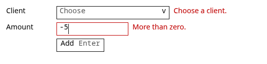
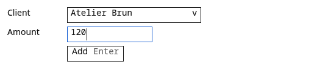

# Forms

A form has one set of rules for both sides: the page shows them as one types, and the app checks them again before it
writes, since it never trusts the page. The rules of a form are a dictionary of its fields, each with its list of
rules: `form.Required`, `form.Above`, `form.Below`, `form.Length`. Write them in a file of their own, which the page
and the app both use.

```cesia
use deps/www-celestial/ceres/src/web
use deps/www-celestial/ceres/src/form
use deps/www-celestial/ceres/src/headless
use std/result
use std/value

Invoice = {
  Client: [form.Required("Choose a client.")],
  Amount: [form.Required("Give an amount."), form.Above(0, "More than zero.")],
}
```

## The app's side: Checked

`form.Checked(rules, args)` gives an `Ok` of the fields that the rules name, all passing, or an `Err` of the kind
"form" with `Errors`, the message of each field that breaks a rule. A field that the rules don't name is left out: a page
can't send more than its form has.

```cesia
form.Checked(Invoice, {Client: 3, Amount: 120, Admin: true}) --> result.Ok({Client: 3, Amount: 120})
form.Checked(Invoice, {Client: 3, Amount: -5}).Error.Errors --> {Amount: "More than zero."}
```

## The page's side: New, View, Values

`form.New(initial, rules)` makes a *draft*, a signal for each field. `form.View(draft, onSubmit, fields)` shows its
fields, one a line, each with its label before it and its message after it, in plain words, then the button of
`form.Submit`, which shows its key: Enter in a field sends the form too. `onSubmit()` runs when no field breaks a rule;
`form.Values(draft)` gives what to send, a number field's value as a number.

The fields are `form.Text`, `form.Number`, `form.Date` (written as 2026-11-25, which it checks) and `form.Choice`,
among the rows of a list or a signal.

```cesia
sent = web.Signal([])
clients = [{Id: 3, Name: "Atelier Brun"}, {Id: 4, Name: "Cave Lemoine"}]
defn page(p)
  draft = form.New({Client: missing, Amount: missing}, Invoice)
  form.View(draft, () -> web.Set(sent, [form.Values(draft)]), [
    form.Choice("Client", clients, c -> c.Id, c -> c.Name),
    form.Number("Amount"),
    form.Submit("Add"),
  ])
end
s = headless.Open(web.App([web.Route("/", page)]), width = 600, height = 200)
s = headless.Type("-5", headless.ClickOn("Amount", s))
s = headless.Press("enter", s)
headless.Tree(s) -->
web.Get(sent) --> []
```

The amount breaks a rule and no client is chosen: each message stands beside its field, and nothing is sent.



Choose a client, fix the amount, and Enter sends:

```cesia
s = headless.Press("down", headless.Press("escape", headless.ClickOn("Client", s)))
s = headless.Type("120", headless.Press("backspace", headless.Press("backspace", headless.ClickOn("Amount", s))))
s = headless.Press("enter", s)
value.Equal(web.Get(sent), [{Client: 3, Amount: 120}]) --> true
```



When `onSubmit` gives the reply of `web.Act`, the line of the button says how it went: Sending…, Sent., or the reason
the app gave; the app's messages of an `Err` of the kind "form" go beside their fields, and an `Ok` empties the form.
`form.Errors(draft)` gives the messages as they stand, `form.Reset(draft)` puts the first values back.
