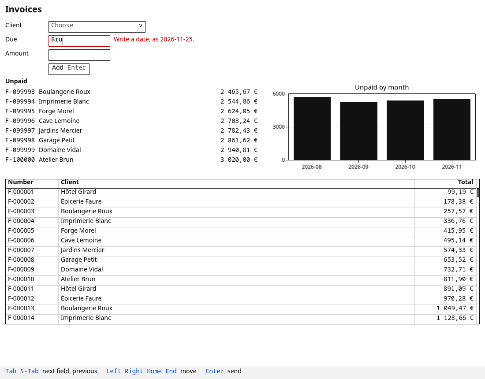

# Ceres

Ceres is the user interface of an app in Cesia: one API for every platform, a page drawn pixel by pixel by Ceres itself,
the way Flutter draws, its data live from the app's server. A page is a function that gives widgets; data that changes
lives in *signals*, and a function given where a widget goes is a *live part*, run again when a signal it read changes,
and only it. There is no virtual DOM, and no work at all while nothing changes.

Its plain look is ink on paper: edges of one pixel, dense rows, tables with real edges, labels beside their fields,
every action a button or a key in sight, numbers at the right, errors in plain words beside what they concern.
`web.Dark` and `web.Light` give the look of a pro tool instead, the materials of Unreal Engine 5's editor on every
platform, at three densities: as the pages of a web app on the web, as docked panels in a window.

1. [A client list with a form, live from Cepheus](guide.md): the tutorial, from the project to its test.
2. [Widgets](widgets.md): signals and live parts, then each widget with a page that uses it.
3. [Forms](forms.md): one set of rules for the page and for the app.
4. [Live data](live.md): shows, actions and big tables from the app's server, over `std/live`.
5. [Ceres in a web page](web.md): a page compiled to WebAssembly, in Chrome and Firefox, then the invoices page live.
6. [Layout like a desktop tool](desk.md): a dock of panels with tabs, an outliner, details, a console, a toolbar and a
   status bar; what a fresh app shows; the keyboard; the dark and light themes and their contrast.
7. [Pages of a web app](pages.md): a side bar of the pages, each at its address, the details in a sheet, the palette of
   Ctrl+K, chips, rows checked, a board of graphs that share a crosshair, three densities, a phone.
8. [Back-ends](backends.md): the draw list and the semantics tree; headless for tests, SDL3 in a window, and the
   browser.
9. [Speed](speed.md): what a frame costs, a live change, a table of 100,000 rows, the memory and the time at rest, in a
   window and in a browser, beside Flutter and SolidJS.

The reference of the packages, every public name with its parameters, is under [Reference](ref/index.html).
