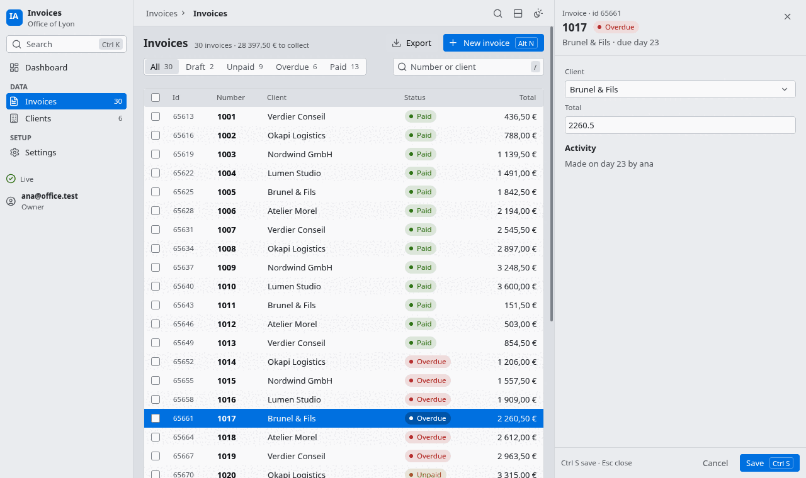
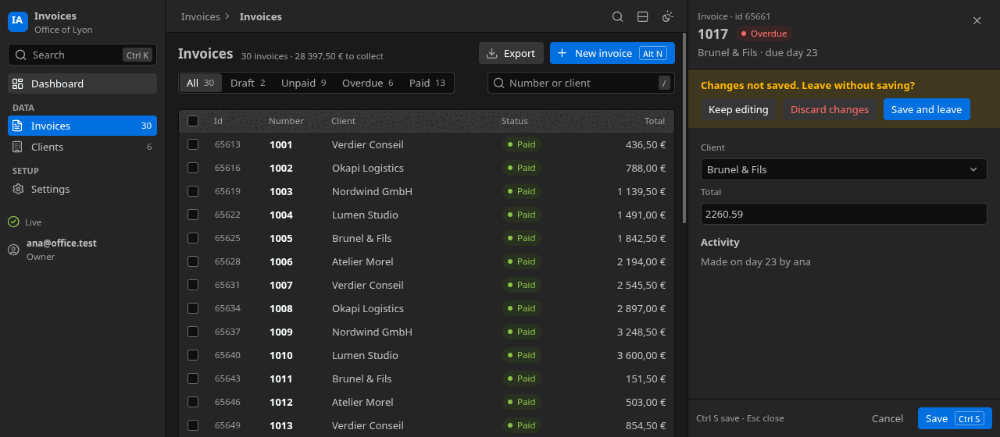
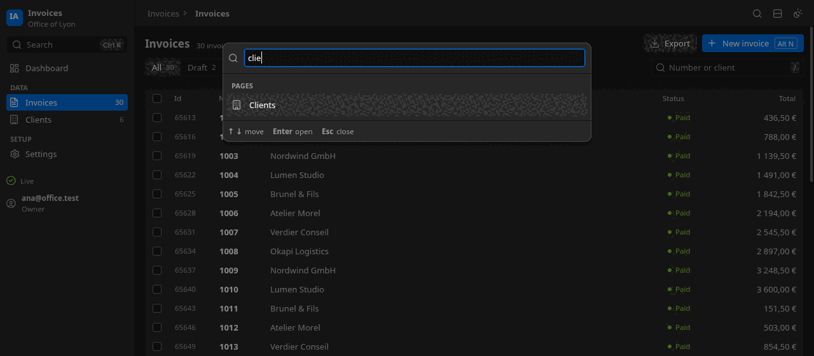
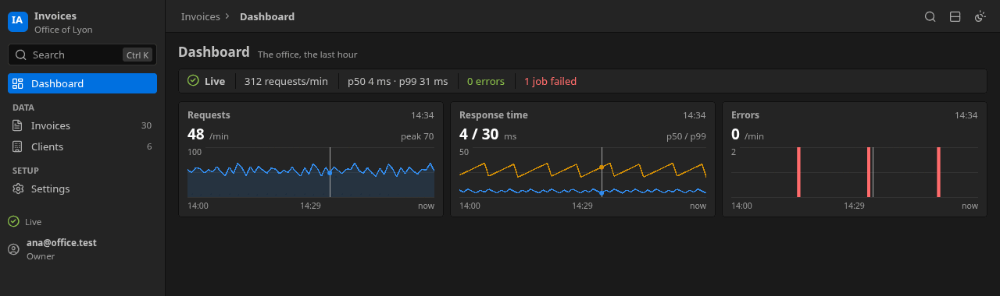
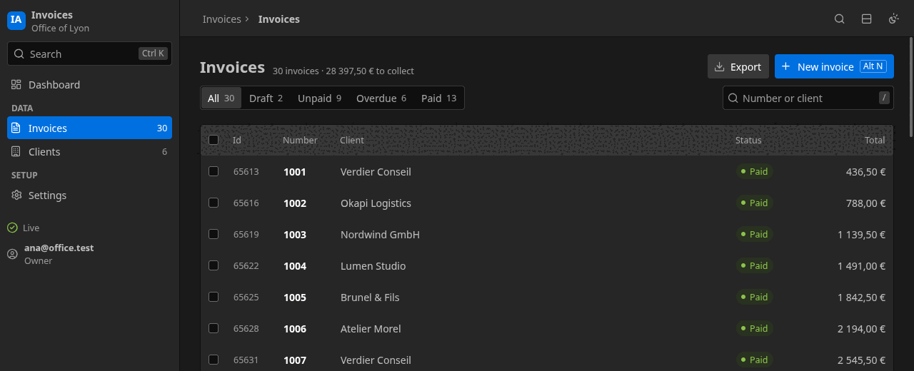
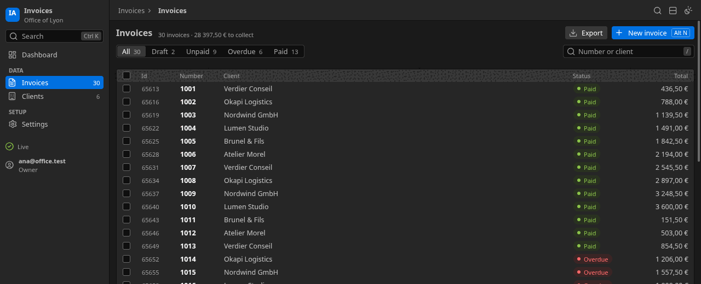
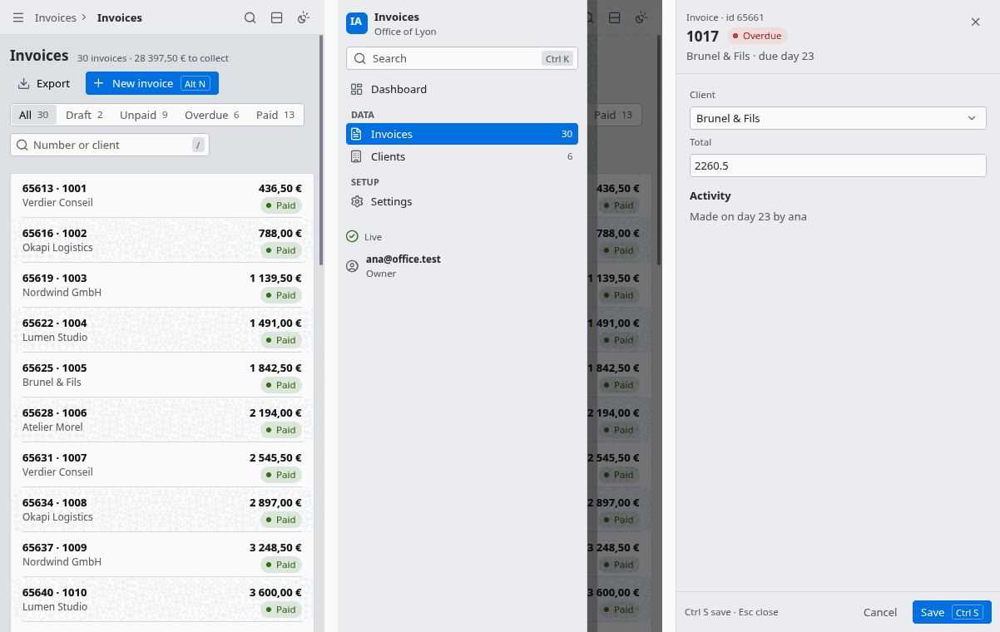

# Pages of a web app

On the web, an app is read as a web site: one view at a time, each at its own address, Back and Forward, a link opened
in a new tab, a page that scrolls. `web.Shell` is that layout. It fills the window: the app's pages in a side bar at the
left, in groups with their counts; a top bar with where one is and the tools of the window; the page in the middle,
which scrolls by itself; and the details of a thing in a sheet at the right. Its materials are those of a desktop tool
(`web.Dark` and `web.Light`, the values of `tokens.md`): only the layout differs from `web.Dock`, which stays the layout
of an app in a window of SDL3. A page that makes none of these widgets holds none of their code.

![The invoices of a small office as the pages of a web app, dark: the side bar with Dashboard, Invoices (30), Clients and Settings, the top bar with the path Invoices › Invoices and the buttons of search, density and theme; the page's title and its summary, the chips of the states with their counts, the search with its key /, the table with a box to check each row, its states as pills and its totals at the right; invoice 1017 opened in the sheet at the right, its fields, Cancel and Save Ctrl S at its foot.](images/pages-dark.png)



The page of these pictures is `examples/pages`: `cesia build --target wasm examples/pages/pages.ce`, then `cesia do
pages` and http://127.0.0.1:8080/.

## The shell, made once

`web.App(routes, frame = f)` takes what stands around every page: `f(p, page)` is called once, with the page of the
first route and `page`, the live part that shows the route shown. The shell stays mounted from route to route; only the
page changes.

```cesia
defn frame(p, page)
  web.Shell(p, page,
    side = [web.Text("Invoices", font = "strong"),
      web.Nav(() -> [web.Group("", [web.Item("Dashboard", icon = "layout-dashboard", to = "/")]),
        web.Group("Data", [web.Item("Invoices", icon = "file-text", to = "/invoices", count = 30),
          web.Item("Clients", icon = "building", to = "/clients", count = 6)])], label = "Pages"),
      web.Spacer(), web.Text("ana@office.test", size = "small")],
    top = [() -> crumbs(web.Get(p.Nav))],
    sheet = () -> opened(web.Get(p.Nav), p),
    find = () -> [web.Command("Invoices", to = "/invoices", group = "Pages", icon = "file-text")],
    view = () -> (if text.StartsWith("/invoices", web.Get(p.Nav)) "/invoices" else web.Get(p.Nav) end))
end

app = web.App([web.Route("/", Dashboard), web.Route("/invoices", Invoices), web.Route("/invoices/:n", Invoices)],
  theme = web.System(), frame = frame)
```

- `side`: the widgets of the side bar, one under the other. A `web.Spacer()` pushes what follows to its foot. With
  `find`, a field of search stands under the first one.
- `web.Nav(groups)`: the pages in groups (`web.Group(title, items)`, its title in small capitals) of `web.Item(label,
  icon, to, count, tone)`; a count in a tone, as `tone = "Danger"` for "1 failed". The row of the route shown is chosen:
  the row whose route is the longest start of the path, so `/invoices` stays chosen at `/invoices/1017`. A row is a link:
  Ctrl or the middle button opens it in a new tab.
- `top`: the widgets of the top bar at its left, as the path of the page. The top bar holds at its right the button of
  the palette, the one that goes round the densities and the one of the theme, each kept on the machine.
- `sheet()`: the details of the thing opened, a `web.Sheet`, or `missing`.
- `view()`: the name of the view shown, which keeps its scroll, the order and the scroll of its tables: a row opened in
  the sheet (`/invoices/1017`) stays in its list's view (`/invoices`), so the list doesn't move.
- `tabs = true` keeps each view opened as a tab under the top bar, as in an editor, and `title()` names it.

## The parts of a page

```cesia
web.Stack([
  web.Header("Invoices", summary = "30 invoices · 20,563.64 € to collect",
    actions = [web.Button("Export", export, icon = "download"), web.Button("New invoice", add, icon = "plus", style = "primary", key = "M-n")]),
  web.Spread(web.Chips(status, [web.Chip("all", "All", count = 30), web.Chip("unpaid", "Unpaid", count = 9)], label = "State"),
    web.Input(search, label = "Search", placeholder = "Number or client", icon = "search", hint = "/")),
  web.Bulk(checks, [web.Button("Mark paid", markPaid, icon = "check")]),
  web.Table(rows, columns, height = missing, label = "Invoices", checks = checks, key = i -> i.Number,
    open = i -> web.Go("/invoices/$(i.Number)", p), picked = picked),
], gap = 10)
```

- `web.Header(title, summary, actions)`: the title of the page, its summary beside it, its actions at the right, under
  it on a phone. One action at most is `style = "primary"`; `"ghost"` is a quiet one, `"danger"` one that deletes.
- `web.Spread(left, right)`: two parts of a line, the second under the first when both don't fit. `web.Row(...,
  wrap = true)` puts the children that don't fit on the next line, as the fields of a filter on a phone.
- `web.Chips(v, options)`: a choice among a few with their counts; Left and Right change it.
- A field with `hint = "/"` is where the key / takes the page, from anywhere.
- `web.Table(..., height = missing)` is as tall as its rows, and the page scrolls. `key(row)` tells rows apart for
  `checks`, a box before each row and one in the header for all; `open(row)` runs when a row is chosen, here its address;
  `picked` marks the row of the address chosen. A state is a `web.Pill(word, tone)`: always its word, never a color
  alone.
- `web.Bulk(checks, actions)`: the band of what can be done to the rows checked, nothing while none is.

## The sheet

```cesia
web.Sheet("1017", web.Stack([web.Text("Total", size = "small", color = "Muted"), web.Input(total, label = "Total", width = 100000)], gap = 6),
  close = () -> web.Go("/invoices", p), kicker = "Invoice · id 65661", sub = "Brunel & Fils · due day 23",
  tag = web.Pill("Overdue", tone = "Danger"),
  foot = [web.Text("Ctrl S save · Esc close", size = "small", color = "Muted"), web.Spacer(),
    web.Button("Cancel", () -> web.Go("/invoices", p), style = "ghost"), web.Button("Save", save, key = "C-s", style = "primary")])
```

From 1280 pixels the sheet stands beside the page, which narrows; under, over it, with a shadow; on a phone it is the
whole window. Esc closes it. A view whose changes aren't saved (`web.Unsaved`) asks in the sheet, under its title, when
one leaves it: Keep editing, Discard changes, or Save and leave, the same as Esc, Ctrl+D and Ctrl+S. The band of keys
at the bottom of the window then asks nothing: `web.Asked()` is where the question is, inline.



A tool of the sheet, `web.IconButton("link", "Copy the link", () -> web.CopyLink(p))`, puts the address of the thing
opened in the clipboard (the page's own address with its route after the `#`), and a toast says so.

## The palette, the toasts

Ctrl+K, or the field of search, opens the palette: the commands of `find()`, each a `web.Command(label, to, on,
group, icon, key)`, found by what one types; Up and Down choose, Enter goes, Esc closes. `web.Toast(p, "Invoice 1017
saved")` shows a short word of what just happened at the bottom of the window for four seconds, read aloud by a screen
reader.



## A board of graphs

`web.Strip(items)` is a line of states at the top of a board, a thin line between two. `web.Metric(title, figure,
series, unit, note, at, cross, style)` is a small graph on its card: its number, its unit and a note, the graph of
its series (`"area"`, `"line"`, or `"bars"` stacked), the top of its scale and the times under it. Graphs given the same
`cross`, a signal, share a crosshair: the mouse over one shows the same moment in all of them, each with its number
then.

```cesia
cross = web.Signal(missing)
web.Row([web.Grow(web.Metric("Requests", i -> value.Text(pick(ns, i)), () -> [{Values: ns, Tone: "S1"}], unit = "/min", at = at, cross = cross)),
  web.Grow(web.Metric("Errors", i -> value.Text(pick(es, i)), () -> [{Values: es, Tone: "Danger"}], unit = "/min", at = at, cross = cross, style = "bars"))], gap = 8)
```



`web.Steps(steps)` is the list of the first steps of an app that has nothing yet, each with its action, a bar above
that says how many are done.

## Densities

Rows of 24, 30 or 44 pixels, texts of 12.5, 13 or 14, fields of 24, 28 or 34: `"dense"`, `"compact"` (the default) and
`"comfortable"` (`web.Densities`), for both layouts. `web.App(density = ...)` gives the app's; the button of the top bar
goes round them; `web.SetLook(p, theme = ..., density = ...)` changes the look while the page runs, and the browser keeps
it on the machine, over the app's: `web.LookOf(p)` reads it.





## On a phone

Under 760 pixels, the side bar is a drawer that the menu button opens, over a veil that a click closes; the rows of a
table are cards of two lines (the first columns as the title, the others under it, the amount and the pill at the
right); the sheet is the whole window; the top bar keeps where one is, a `web.Wide(...)` part only on a wider window.



## Keys and a screen reader

Tab goes from widget to widget in the order of the page: the side bar, the top bar, the page, the sheet. In the side bar
Up and Down move along the rows, Enter goes; on chips Left and Right choose; in a table that opens its rows, Up and Down
choose a row and Enter opens it. Ctrl+K opens the palette, / the search, Esc closes the palette, the drawer or the
sheet. The hidden DOM holds a navigation of links (the row of the route selected), the chips as a group of radios, the
sheet's question as an alert with its answers, the palette as a dialog of options, a toast as a status. Each text over
each surface it is drawn on reaches 4.5:1 in both themes (tests/shell.test.ce measures every text of the example).
