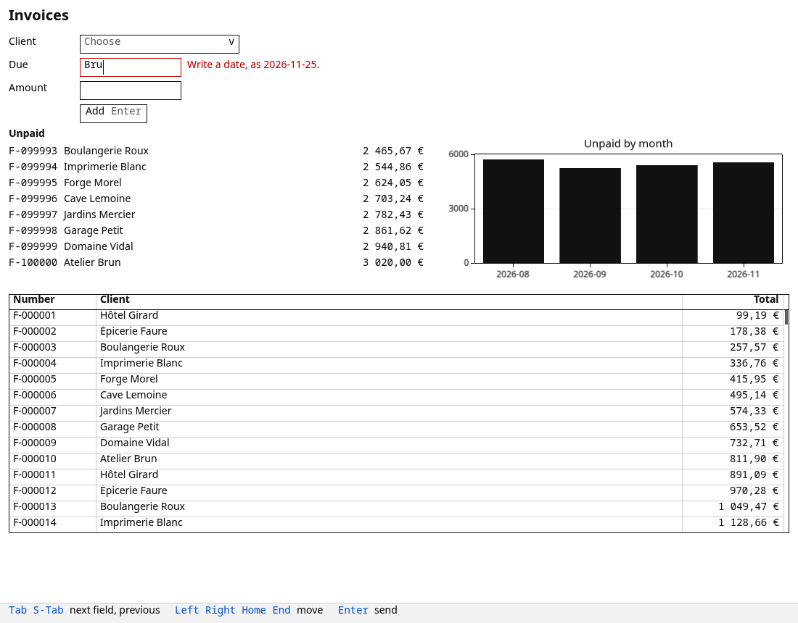

# Ceres in a web page

In this tutorial you put a page of Ceres in a browser. Its code, Ceres's and yours, is compiled from Cesia to
WebAssembly by `cesia build --target wasm`, and runs in the page: no JavaScript of yours, no interpreter, the same page
as in a window. You start with a page alone, a counter and a field, then the invoices page of the guide, live from its
app.

## 1. A page alone

`examples/hello/hello.ce` is a page and the line that runs it in a browser, `browser.Run`, where a window would call
`sdl.Run`:

```cesia norun
(* A page of Ceres in a browser: a counter and a field that greets, compiled to WebAssembly by
   cesia build --target wasm examples/hello/hello.ce, served by examples/hello/serve.ce. *)
use src/browser
use src/web

n = web.Signal(0)
name = web.Signal("")
defn greeter(p)
  (** A button that counts, a field, and a greeting that follows both. *)
  web.Stack([
    web.Title("Hello"),
    web.Row([web.Button("Add one", () -> web.Set(n, web.Get(n) + 1), key = "C-a"), () -> web.Text("Clicked $(web.Get(n)) times")]),
    web.Row([web.Text("Your name"), web.Input(name, label = "Your name", width = 200)]),
    () -> web.Text(if web.Get(name) == "" "Type your name." else "Hello, $(web.Get(name))!" end),
  ])
end
browser.Run(web.App([web.Route("/", greeter)], title = "Hello — Ceres"))
```

Compile it:

```bash
cesia build --target wasm examples/hello/hello.ce
```

Beside `hello.ce` come `hello.wasm`, the module; `hello.js`, its loader; `ceres.js`, the glue that `src/browser` calls,
which the build copies from `web/ceres.js`; and `hello.sites`, the places of the errors, which the loader reads only at
an error. The page that holds it is a canvas and the loader, `examples/hello/index.html`:

```html
<!doctype html>
<meta charset="utf-8">
<meta name="viewport" content="width=device-width, initial-scale=1">
<title>Hello — Ceres</title>
<style>html, body { margin: 0; height: 100%; } #page { width: 100%; height: 100%; }</style>
<div id="page"><canvas></canvas></div>
<script type="module" src="hello.js"></script>
```

A browser runs a module only from a server. `examples/hello/serve.ce` serves the folder, and `cesia do hello` runs it:

```cesia norun
(* The files of examples/hello on port 8080 of this machine: cesia do hello, then open http://127.0.0.1:8080/. *)
use std/http

http.Serve(http.App() then http.Static("", "examples/hello"))!
```

Open <http://127.0.0.1:8080/>. Two clicks on Add one and "Ana" typed in the field give "Clicked 2 times" and "Hello,
Ana!", in Chrome 158 and in Firefox 160. The canvas fills its parent; Tab goes from field to field, and the band of keys
at the bottom shows the keys, as in a window.

## 2. What runs

`browser.Run(app)` is the loop of `src/sdl`, its window the canvas:

1. It asks `ceres.js` to set the canvas up and to send each event of the page, a click, a key, a text typed, a new size,
   as the list of its fields on a channel of `std/fiber`; `ceres.js` gives back the canvas's size and the page's origin.
2. It mounts the app with `web.Start`, its texts measured by the browser's own fonts.
3. It waits on the channel. While it waits, nothing of the page's code runs: the browser is free, and a still page costs
   nothing. A fiber that waits sets its stack aside by JavaScript Promise Integration, which Chrome runs since 137,
   Firefox since 153 and Safari since 27.
4. An event comes: `web.Handle`, then `web.Update`. When the page changed, it asks the browser for its next frame, and
   paints it then: the draw list, `web.Encoded`'s bytes, made again only for the boxes laid out since, by WebGL2 in one
   draw call, and what changed in the semantics tree, `web.Patch`, in a hidden DOM, where a screen reader reads and
   where a field is a real `<input>`: a frame costs what changed in it.

The two sides speak by `js.Call` of `std/js`, the page's code calling `ceres.js`, and by that one channel, `ceres.js`
sending the events: the whole of what crosses is in the header of `web/ceres.js`.

## 3. The invoices page, live

The page of [the guide](guide.md), with its live screen, is `examples/invoices/browser.ce`, three lines:

```cesia norun
use examples/invoices/page
use src/browser
use src/web

browser.Run(web.App([web.Route("/", page.Page)], live = "/live", title = "Invoices — Ceres"))
```

Its live screen opens at the origin of the page, its own server: `examples/invoices/serve.ce` serves the files of
`examples/invoices` and the app's screen at `/live`, as `examples/invoices/main.ce` serves them to a window; every 4
seconds, an accountant pays an invoice elsewhere.

```bash
cesia build --target wasm examples/invoices/browser.ce
cesia do web
```

Open <http://127.0.0.1:8080/browser.html>: the form, the unpaid invoices, the graph by month and the table of 100,000
invoices, as in the window; one paid elsewhere leaves the list without a reload. The screen of the app is a WebSocket of
the page, which `std/websocket` is in a page, and when it brings something, it wakes the loop of step 2: nothing polls.



## 4. A test in a browser

`tools/webshot.sh` builds the page, serves it with its app, and opens `tests/web/page.html` in Chrome without a window,
driven by its DevTools protocol from Cesia, `tools/webshot.ce`. The page plays a person: it waits for the rows of the
table, clicks into the field Due, types "Brun", then Backspace and a space, and writes what the page showed in its
title:

```bash
CHROME=chrome-headless-shell tools/webshot.sh
```

```text
done 17 rows, 2 inputs, field Bru, input left "", painted again true, measure 54
```

17 rows in the hidden DOM, the header and the rows in sight; the field holds "Bru", the page having taken the text and
then the key; the hidden input is empty again, its text gone to the page; a frame was painted after; "Invoices" is 54
pixels wide in the browser's font. The picture goes in `shots/invoices-webgl.png`. The same page gives the same line in
Firefox 160. With `?ceres-check` in its address, it also checks the hidden DOM against the semantics tree after every
frame, and its line ends with what it found: [Back-ends](backends.md).

[Speed](speed.md#in-the-browser) gives what a frame costs in the page.
