# Widgets

Every widget is a value that a function of `web` makes: a dictionary with a `Kind`, which the page's runtime mounts,
lays out and draws. Each example below is a whole page run on the headless back-end, which draws without a window, and
shows the page's semantics tree, what a screen reader reads, each widget at its place in pixels. The headless text is
7 pixels a character and 21 a line at the size 14, so the places can be checked by hand.

The pictures are these widgets in Chrome, compiled to WebAssembly, after the steps they say; `tools/docshots.sh`
takes them all again.

```cesia
use deps/www-celestial/ceres/src/web
use deps/www-celestial/ceres/src/headless
use std/plot

(* A page of one widget, opened in a window of 600 by 300 pixels. *)
one(w) = headless.Open(web.App([web.Route("/", _ -> w)]), width = 600, height = 300)
```

## Signals

A *signal* is a value that changes, as in SolidJS: `web.Signal(v)` makes one, `web.Get(s)` reads it, `web.Set(s, v)`
changes it. A function given where a widget goes is a *live part*: the runtime runs it once, notes the signals it read,
and runs it again, it alone, when one of them changes. Nothing else of the page is looked at again, and nothing runs at
all while nothing changes: there is no virtual DOM to compare.


```cesia
n = web.Signal(1)
page = one(web.Stack([() -> web.Text("n is $(web.Get(n))")]))
web.Set(n, 2)
headless.Tree(web.Update(page)) -->
```

`web.Memo(f)` is a signal computed from others, before the live parts that read it, so that a part never sees it older
than its signals (a *glitch*, in the words of Bainomugisha et al., 2013). `web.IsSignal(x)` tells a signal from a
value.

```cesia
price = web.Signal(10)
taxed = web.Memo(() -> web.Get(price) * 1.2)
web.Get(taxed) --> 12.0
web.IsSignal(taxed) --> true
```

## Text and Title

`web.Text(x)` shows a value, a signal as it changes, or a live function. A long text breaks between words. Numbers and
amounts are in the code font, whose figures line up; `font` gives "body", "strong" or "code". `web.Title` is a strong,
larger text: a heading.

```cesia
headless.Tree(one(web.Stack([web.Title("Invoices"), web.Text(42), web.Text("unpaid", font = "strong")]))) -->
```

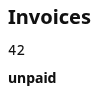

## Stack, Row, Grow, Spacer, Divider

`web.Stack` puts widgets one under the other, `web.Row` side by side; `gap` is the space between them, `pad` the space
inside. In a row each child is as wide as it needs, and those that `web.Grow` marks share what is left; `web.Spacer()`
is such a share, empty. `web.Divider()` is a thin line across.

```cesia
headless.Tree(one(web.Row([web.Text("Total"), web.Spacer(), web.Text(12.5)]))) -->
```

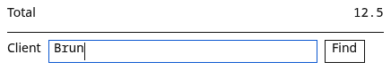

## Button

A plain button, its label in an edge of one pixel. `key` gives it a key of its own, "C-s" for Ctrl and s: the button
shows it beside its label, the band of keys lists it, and the key presses it from anywhere in the page.

```cesia
saved = web.Signal(0)
page = one(web.Button("Save", () -> web.Set(saved, web.Get(saved) + 1), key = "C-s"))
page = headless.Press("s", page)
web.Get(saved) --> 0
page = web.Handle({Kind: "key", Key: "s", Ctrl: true, Alt: false, Shift: false}, page)
web.Get(saved) --> 1
```

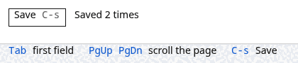

## Input

A field of one line, bound to a signal of a text: typing changes the signal, and a change of the signal shows. Its text
is in the code font. `onEnter` runs on Enter; `invalid` draws it as wrong, as a form does.

```cesia
name = web.Signal("")
page = headless.Type("Ana", headless.ClickOn("Name", one(web.Input(name, label = "Name"))))
web.Get(name) --> "Ana"
```

`secret = true` makes it the field of a password: it shows a dot for each character, the tree of semantics (what a
screen reader and a test read) holds the dots only, and in a browser its hidden input is of the type `password`, which
the browser's manager of passwords fills.

```cesia
pass = web.Signal("")
page = headless.Type("hunter2", headless.ClickOn("Password", one(web.Input(pass, label = "Password", secret = true))))
web.Get(pass) --> "hunter2"
```

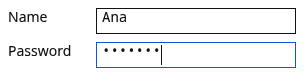

## Select

A choice among options, a list or a signal of rows: the signal it is bound to holds the key of the chosen one. A click
opens the list under it; Up and Down change the choice while it has the focus.

```cesia
city = web.Signal(missing)
cities = [{Id: 1, Name: "Lyon"}, {Id: 2, Name: "Nice"}]
page = one(web.Select(city, cities, c -> c.Id, c -> c.Name, name = "City"))
page = headless.Press("down", headless.Press("down", headless.Press("escape", headless.ClickOn("City", page))))
web.Get(city) --> 2
```

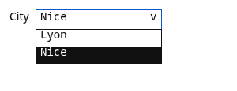

## Each

A list that follows a signal of rows, a widget for each row. Rows are told apart by their key: when the rows change, the
widgets of the rows that stay are kept, those of new rows are made, those of rows gone are dropped.

```cesia
rows = web.Signal([{Id: 1, Name: "Ana"}, {Id: 2, Name: "Bo"}])
page = one(web.Each(rows, r -> r.Id, r -> web.Text(r.Name)))
web.Set(rows, [{Id: 2, Name: "Bo"}, {Id: 3, Name: "Cy"}])
headless.Tree(web.Update(page)) -->
```

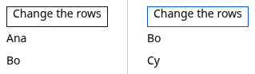

## Table and Column

A big table: only the rows in sight are drawn, so 100,000 rows cost as 30. The rows come from a list or a signal of a
list, sorted here, or from the app a window at a time with `web.Pages` (the chapter [Live data](live.md)). A click on
the title of a column with `sort` sorts by it; numbers and amounts go to the right of their column.

```cesia
rows = [{Number: "F-$k", Total: k * 10} for k in 1..100000]
table = web.Table(rows, [web.Column("Number", r -> r.Number, sort = "Number"), web.Column("Total", r -> web.Money(r.Total))], height = 120, label = "Invoices")
page = headless.Wheel(100, 60, -1000, one(table))
headless.Tree(page) -->
```

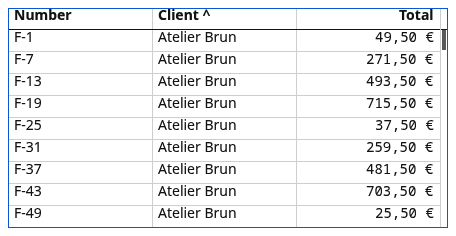

## Plot

A graph of std/plot, drawn by Ceres: `web.Plot` takes a function that gives one, a live part, drawn again when a signal
it read changes. M4 (Jugel et al., VLDB 2014), which std/plot applies to long lines, keeps a line of a million points
as a few points for each column of pixels.

```cesia
months = web.Signal([{Month: "Oct", Total: 340}, {Month: "Nov", Total: 80}])
graph = web.Plot(() -> plot.Of([plot.Bars([m.Month for m in web.Get(months)], [m.Total for m in web.Get(months)])], title = "Unpaid by month"), height = 200)
headless.Tree(one(graph)) -->
```

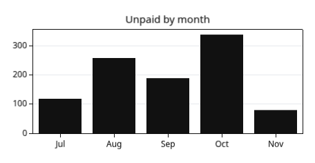

## Money and Grouped

`web.Money(x)` is an amount as a text widget in the code font, two digits after the point, its thousands apart, as a
French page writes it; `web.Grouped` gives the text alone.

```cesia
web.Money(1234.5).Text --> "1 234,50 €"
web.Grouped(1234.5, decimal = ".", group = ",") --> "1,234.50"
```

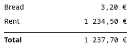

## Link, routes and Go

An app is its routes, `web.Route(pattern, page)`: a part of the path written `:name` goes into `p.Params`. `web.Link`
goes to another route, as `web.Go(path, p)` does from code.

```cesia
home = p -> web.Link("Invoice 42", "/invoices/42")
invoice = p -> web.Title("Invoice $(p.Params.id)")
app = web.App([web.Route("/", home), web.Route("/invoices/:id", invoice)])
headless.Tree(headless.ClickOn("Invoice 42", headless.Open(app))) -->
```

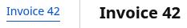

## The band of keys

Every action is in sight with its key: at the bottom of the window, a band lists the keys of the widget in focus and
those of the buttons that have one. `web.Keys(page)` gives them; `web.Theme` with `Keys: false` hides the band.

```cesia
page = headless.ClickOn("Name", one(web.Input(web.Signal(""), label = "Name")))
web.Keys(page) -->
```

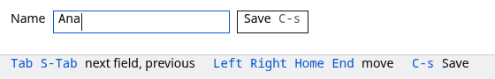
